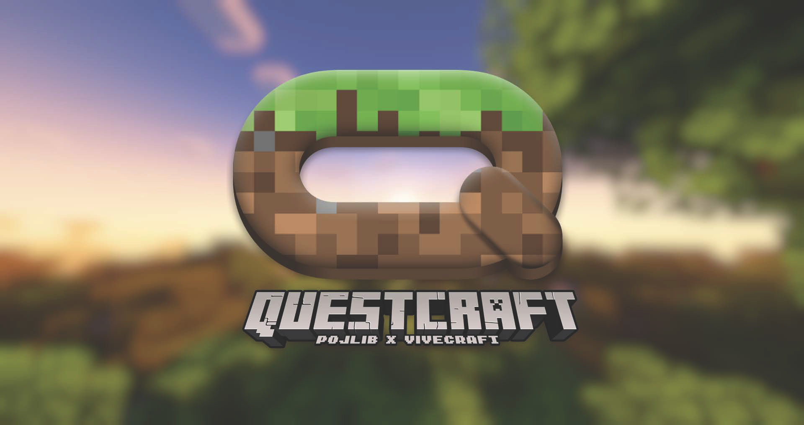

# QuestCraft 26.2 personal v72 لـ Meta Quest 3

يشغّل QuestCraft لعبة Minecraft: Java Edition داخل نظارة Meta Quest. هذا
المستودع يحتوي على بناء شخصي وتجريبي من Vivecraft 26.2 مخصص لـQuest 3.

> [!WARNING]
> النسخة `v72` هي **pre-release** وليست إصدار QuestCraft مستقرًا عامًا.
> يحتاج تفعيل Developer Mode والموافقة على USB debugging إلى شخص بالغ وحاسوب
> موثوق. اقرأ دليل التثبيت وخذ نسخة احتياطية قبل ترقية نسخة موجودة.

## ابدأ من هنا

1. افتح **[دليل التثبيت خطوة بخطوة](INSTALLATION.md)**.
2. نزّل ملف الـAPK ذي الاسم الموضح أدناه من صفحة الإصدار الرسمية فقط.
3. لا تثبّت الملف حتى يطابق فحص SHA-256 القيمة المنشورة حرفيًا.

**English:** Start with the Arabic-first
**[beginner installation guide](INSTALLATION.md#english-quick-summary)**. It
includes Windows/ADB setup, backup, fresh install, upgrade, verification,
troubleshooting, and rollback.

## النسخة المنشورة الموثقة

<!-- markdownlint-disable MD013 -->

| العنصر | القيمة |
| --- | --- |
| صفحة الإصدار | [`v72-personal.13-perfbase-cd079c65`](https://github.com/Akramx15/questcraft-26.2-v72/releases/tag/v72-personal.13-perfbase-cd079c65) |
| اسم APK | `QuestCraft-Vivecraft-26.2-personal.13-perfbase-cd079c65.apk` |
| SHA-256 | `6748C17071B90ED5DC236FBA84CA3BBC4DEAED54C802D0150CFA82B20EFA3680` |
| الحزمة | `com.qcxr.qcxr.dev262` |
| الاسم الظاهر | `Vivecraft Stable` |
| الإصدار | `versionCode 72` / `6.0.1-26.2-vivecraft-personal.13` |
| مصدر APK | private development commit `cd079c65` (ليس ضمن التاريخ العام المضغوط) |
| نتيجة فحص البناء | [`build-receipt-public.json`](https://github.com/Akramx15/questcraft-26.2-v72/releases/download/v72-personal.13-perfbase-cd079c65/build-receipt-public.json) |

<!-- markdownlint-enable MD013 -->

- **[افتح صفحة الإصدار والتنزيل](https://github.com/Akramx15/questcraft-26.2-v72/releases/tag/v72-personal.13-perfbase-cd079c65)**
- **[نزّل ملف APK مباشرة](https://github.com/Akramx15/questcraft-26.2-v72/releases/download/v72-personal.13-perfbase-cd079c65/QuestCraft-Vivecraft-26.2-personal.13-perfbase-cd079c65.apk)**

يثبت هذا البناء بالحزمة المنفصلة `com.qcxr.qcxr.dev262`، لذلك لا يستبدل حزمة
QuestCraft العامة `com.qcxr.qcxr`. أما إذا كانت الحزمة `dev262` موجودة بالفعل،
فاتبع مسار **الترقية** في الدليل ولا تعاملها كتثبيت جديد.

## أربع قواعد تمنع أكثر الأخطاء شيوعًا

1. لا تحذف التطبيق ولا instance باسم `26.2` لإصلاح مشكلة ترقية.
2. لا تستخدم `adb uninstall` قبل نسخة احتياطية مفحوصة؛ إلغاء التثبيت قد يزيل
   العوالم والإعدادات وحالة تسجيل الدخول.
3. `adb install -r` يحافظ عادةً على بيانات الحزمة، لكنه **لا يطابق أو يحدّث
   مجلد المودات الحي تلقائيًا**. افحص المودات كبيانات مستقلة.
4. لا تستخدم APK من مرآة أو رسالة خاصة إذا فشل الرابط الرسمي.

## ماذا يعني «موثق» هنا؟

إيصال الإصدار يثبت أن ملف APK اجتاز فحوص البناء، والحزمة والإصدار والتوقيع
والمحاذاة ومحتوى Vulkan/OpenXR، وأن بصمته هي القيمة المنشورة. إيصال البناء نفسه
يسجل أن تلك العملية لم تثبّت APK على جهاز. لذلك لا يصبح نجاح جهازك مؤكدًا إلا
بعد ظهور `Success` من ADB، وتحقق رقم الإصدار، والوصول إلى قائمة Minecraft
الرئيسية داخل VR.

## ما الذي لا يأتي داخل APK؟

- QGO غير مضمّن وغير مطلوب للتثبيت. استخدمه فقط إذا كنت تملكه ومثبتًا لديك
  أصلًا، واتبع القسم الاختياري في دليل التثبيت.
- Distant Horizons وحزم المودات التجريبية وإعداد سيرفر Minecraft ليست جزءًا من
  هذا الإصدار الموثق.
- إعدادات الجهاز أو حلول Hand Tracking الخاصة بجهاز اختبار ليست ميزات داخل
  APK ولا متطلبات عامة.
- إصلاح self-heal اللاحق لمعالجة asset index التالف موجود في **المصدر فقط**
  ضمن هذه اللقطة العامة، لكنه **غير موجود** في APK المنشور؛ فقد بُني APK من
  private development commit `cd079c65`. يشرح الدليل الحل اليدوي الآمن
  للنسخة الحالية.

## للمطورين

مصدر خط v72 المنشور موجود في
[`Akramx15/questcraft-26.2-v72`](https://github.com/Akramx15/questcraft-26.2-v72).
هذا المستودع يبدأ بتاريخ عام جديد ومضغوط، ولا يحمل فروع أو commits مستودع
التطوير الخاص. لا تفترض أن أحدث مصدر موجود داخل APK؛ هوية الملف المنشور
مجمدة عند private development commit `cd079c65`.

- `Vivecraft-26.2-Quest/` — تكامل Vivecraft الخاص بـQuest 26.2.
- `Pojlib/` — Java runtime وتثبيت Minecraft والأصول المدارة.
- `QCXR-XR-Wrapper/` — مشغل Unity وتسليم جلسة OpenXR.
- [BUILDING.md](BUILDING.md) — سلسلة البناء ومزامنة JAR ثم AAR ثم APK.
- [AI_HANDOFF.md](AI_HANDOFF.md) و[MODS.md](MODS.md) — سجل Dev.2 هندسي
  تاريخي، وليس وعدًا بمحتوى APK v72 المنشور.

لا ترفع APKs أو سجلات الأجهزة أو العوالم أو بيانات الحساب أو serials أو
keystores إلى Git.

## المشاريع الأصلية والدعم العام

يبني هذا العمل على
[Vivecraft](https://github.com/Vivecraft/VivecraftMod)،
[PojavLauncher](https://github.com/PojavLauncherTeam/PojavLauncher)، Fabric،
LWJGL، وOpenXR. راجع تراخيص كل مكوّن قبل إعادة التوزيع.

- [إصدارات QuestCraft العامة](https://github.com/QuestCraftPlusPlus/QuestCraft/releases)
- [موقع QuestCraft](https://questcraft.org/)
- [مجتمع QuestCraft على Discord](https://discord.gg/questcraft)
